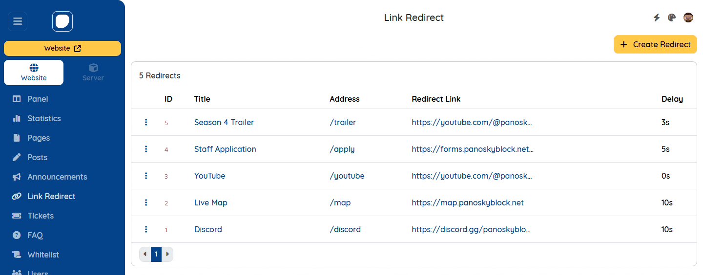
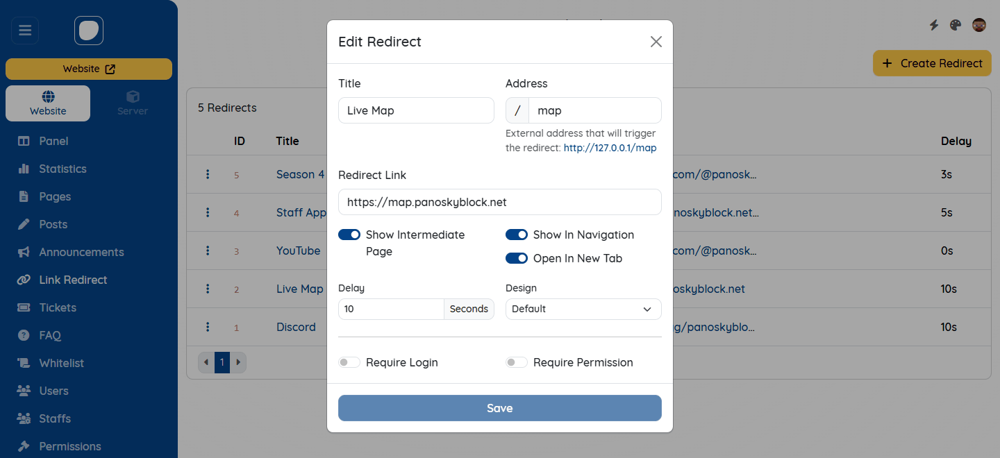

  
  <h1>Link Redirects</h1>
  
<b>Short, memorable links for your Discord, map, videos and more.</b>

  

    
    
    
  

Give your players short, easy links. Link Redirects turns addresses like yoursite.com/discord or yoursite.com/map into links to any page you choose. Share one simple link everywhere, change where it goes any time, and even add it to your website menu.

## ✨ Features
- 🔗 **Short links**: create easy addresses like /discord, /map or /apply on your own website.
- ⏳ **Waiting page**: show a "Redirecting..." page with a countdown before players leave.
- 🎨 **Several designs**: pick a default, minimal or modern waiting page, or build your own.
- 🧭 **Menu links**: add any redirect to your website menu with one switch.
- 🪟 **New tab**: open the link in a new tab so players stay on your site.
- 🔒 **Members only**: require players to log in, or to have a certain rank, before the link works.
- ✏️ **Change any time**: update where a link goes without changing the link you already shared.

## 📸 Screenshots

<i>Set the address, delay, design and who can use each link.</i>

<i>The modern waiting page players see before they are sent on.</i>

## 🚀 Get started
1. Open your Pano panel and go to **Addons**.
2. Find **Link Redirects** and click **Install**.
3. Open **Link Redirect** in your panel and click **Create Redirect**.

## 💬 Support
Questions or ideas? Join our [Discord](https://panomc.com/discord) or visit [panomc.com](https://panomc.com).

## 📄 License
Released under the MIT License.
